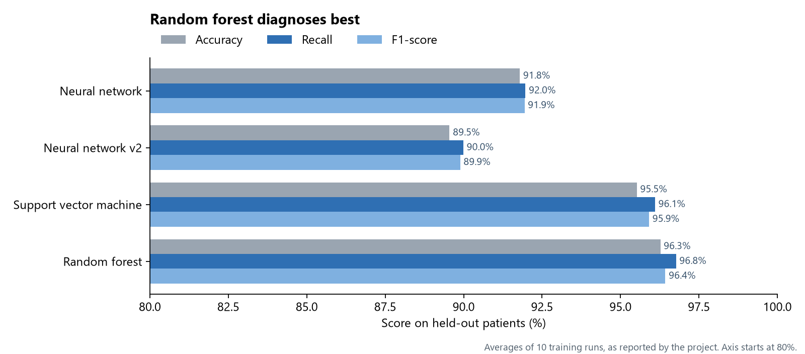
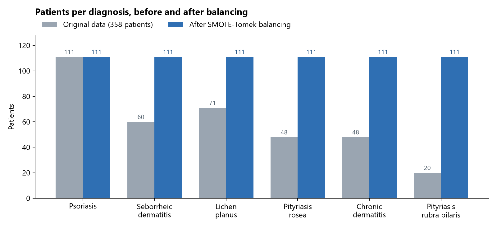
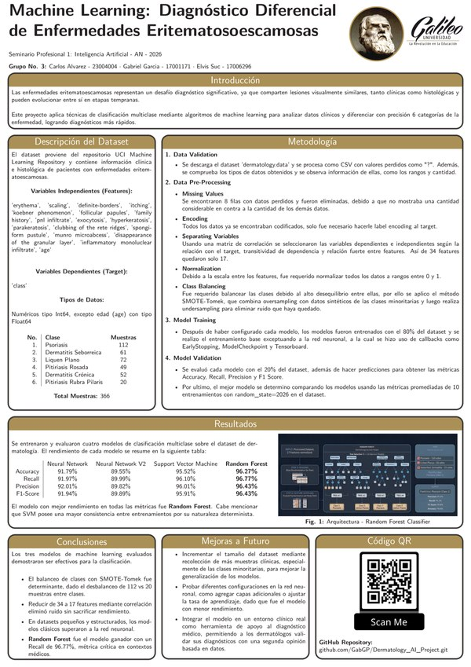

<h1 align="center">Telling Six Skin Diseases Apart with Machine Learning</h1>

<p align="center">
  <strong>A model that suggests a diagnosis from 17 clinical and lab findings, right about 96% of the time.</strong><br>
  Six skin diseases look almost the same, to the eye and under the microscope. This project trains and compares four models to tell them apart.
</p>

<p align="center">
  
</p>

<p align="center">
  <a href="https://colab.research.google.com/github/GabGP/Dermatology_ML_Project/blob/main/Dermatology_AI_Model.ipynb">Open in Colab</a> ·
  <a href="#results">Results</a> ·
  <a href="#how-it-works">How it works</a> ·
  <a href="Dermatology_Dataset_Poster.pdf">Poster (PDF, in Spanish)</a>
</p>

---

## The problem

Psoriasis, seborrheic dermatitis, lichen planus, pityriasis rosea, chronic dermatitis and pityriasis rubra pilaris all cause red, scaly skin. They share symptoms, look alike under the microscope, and one can turn into another in early stages, which makes them hard to tell apart. A model that reads a patient's findings and suggests the most likely diagnosis can give a dermatologist a fast, data-backed second opinion.

---

## Results

Four models were trained on 80% of the patients and tested on the other 20%. Scores are averages over 10 training runs:

| | Neural network | Neural network v2 | Support vector machine | **Random forest** |
| :--- | :---: | :---: | :---: | :---: |
| Accuracy | 91.79% | 89.55% | 95.52% | **96.27%** |
| Recall | 91.97% | 89.99% | 96.10% | **96.77%** |
| Precision | 92.01% | 89.82% | 96.01% | **96.43%** |
| F1-score | 91.94% | 89.89% | 95.91% | **96.43%** |

- **The random forest won on every measure**, including recall, the one that matters most in medicine because it counts how many sick patients are correctly identified.
- **The support vector machine came a close second** and gave the most consistent results from run to run.
- **On a small, tidy dataset like this one, the classic models beat the neural networks.**

---

## How it works

**The data.** 366 patients from the [UCI Dermatology dataset](https://archive.ics.uci.edu/dataset/33/dermatology), each described by 34 clinical and lab findings (such as itching, scaling, family history and age) plus the confirmed diagnosis.

**Preparing it.**

1. **Clean:** 8 patients with missing values are removed, leaving 358.
2. **Keep what matters:** a correlation analysis cuts the 34 findings down to 17, dropping the ones that add noise or repeat each other.
3. **Put everything on one scale:** each finding is rescaled to between 0 and 1.
4. **Balance the diagnoses:** the rarest disease had only 20 patients against 111 for the most common one. SMOTE-Tomek creates realistic synthetic patients for the smaller groups, then removes borderline cases that blur the line between groups, so every diagnosis ends up with 111.

<p align="center">
  
</p>

**Training and comparing.** A neural network (in two versions), a support vector machine and a random forest are trained on the same 80% of the data and scored on the remaining 20%.

---

## Run it

The notebook was built for Google Colab: [open it there](https://colab.research.google.com/github/GabGP/Dermatology_ML_Project/blob/main/Dermatology_AI_Model.ipynb) and choose **Runtime → Run all**. It downloads the dataset from UCI on its own.

To run it locally instead, install the libraries it uses:

```bash
pip install tensorflow scikit-learn imbalanced-learn pandas numpy matplotlib seaborn jupyter
```

The download cell uses the shell commands `rm` and `wget`. On Windows, download [`dermatology.data`](https://archive.ics.uci.edu/ml/machine-learning-databases/dermatology/dermatology.data) into the project folder yourself and skip that cell.

---

## Poster

<p align="center">
  <a href="Dermatology_Dataset_Poster.pdf"></a>
</p>

---

## Team

Group 3, Professional Seminar 1: Artificial Intelligence, Galileo University, 2026.

- Carlos Alvarez
- Gabriel Garcia ([@GabGP](https://github.com/GabGP))
- Elvis Suc

The data is the [Dermatology dataset](https://archive.ics.uci.edu/dataset/33/dermatology) by Nilsel İlter and H. Altay Güvenir, from the UCI Machine Learning Repository (CC BY 4.0).
